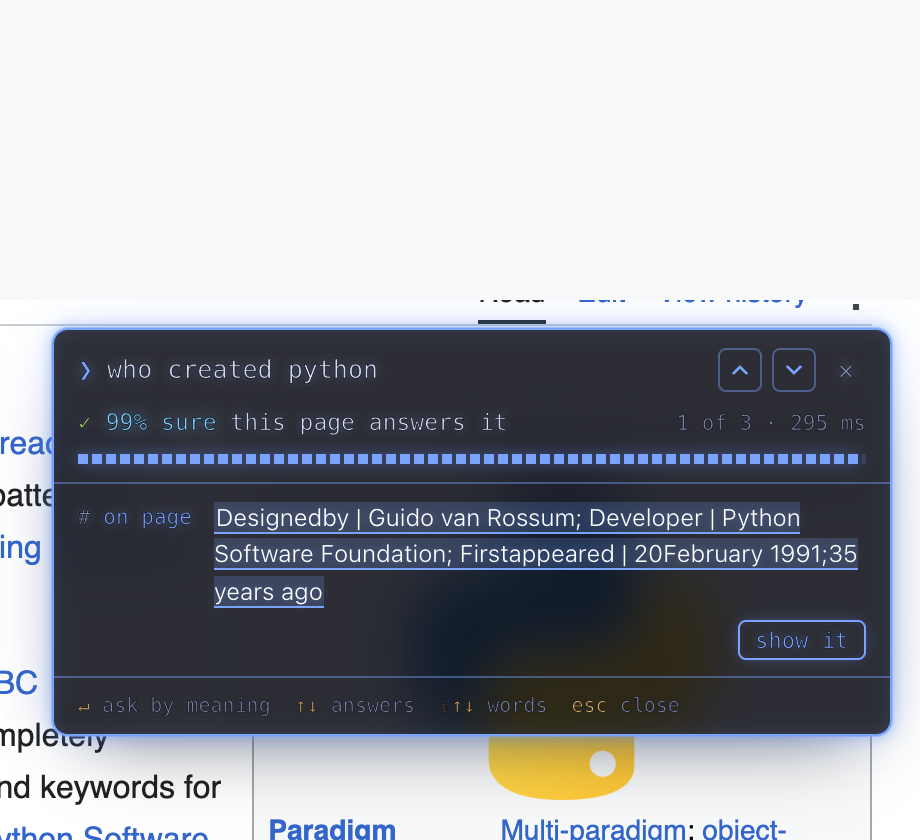

# Pareto

A Chrome extension for finding things by meaning. Ask a question about the page you're reading, and it jumps to the sentence that answers it. It also shows the sources that sentence cites and an AI-written short answer. As you type, anything that appears word for word on the page lights up, like normal Ctrl+F.

It finds the answer with [Jev](https://docs.typesafe.ai) from TypeSafe AI. On a long Wikipedia article it got 10 of 10 test questions right, with a median of 227 ms from Enter to highlight. The box appears about 4 ms after the shortcut. See [TESTS.md](TESTS.md).

Everything else that needs a model runs on **NVIDIA Nemotron**, served by **Nebius Token Factory**. Nemotron 3 Super writes the short answer, Nemotron 3 Ultra thinks harder about questions that need the whole page (⌘ Enter), and Nemotron 3.5 Lightning finds the answer whenever Jev can't. With only a Nebius key, Pareto works end to end on Nemotron. See [Nemotron on Nebius Token Factory](#nemotron-on-nebius-token-factory).

Without a key, it finds words as you type, on your computer only. Add a Jev or Nebius key and it also searches by meaning and writes AI answers.

**There's a Mac app too:** a search bar for the whole Mac (⌥ Space). It opens apps and files in plain English, answers questions about the window in front (PDFs included), and takes voice. It lives in its own repo: [pareto-mac](https://github.com/zohane112/pareto-mac).



More screenshots: [compare mode](docs/compare.png) and [settings](docs/settings.png).

## Set up

1. **Load the extension:** open `chrome://extensions` and turn on **Developer mode** (top right). Then click **Load unpacked** and choose the `extension` folder. If it's already loaded, click the reload arrow on its card instead.

2. **Add your keys (optional):** on the extension's card, click **Details**, then **Extension options**. Search by meaning needs a Nebius key, a Jev key, or both:
   - **Nebius key (Nemotron):** get one at [tokenfactory.nebius.com](https://tokenfactory.nebius.com/), paste it under **Nebius key, for NVIDIA Nemotron**, and click **Save**. Click **Check the key**: it should show Lightning ✓ Super ✓ Ultra ✓. This one key covers finding, written answers and think harder.
   - **Jev key (optional, fastest finding):** paste a key from [console.typesafe.ai/keys](https://console.typesafe.ai/keys) under **Jev API key** and click **Save**.
   - **Privacy:** in your Nebius account profile, switch on **Zero Data Retention**. Until it's on, Nebius keeps what it's sent.

3. **Use it:** on any web page, press **Control+Shift+F** (or click the magnifier icon in the toolbar) and type a question.

That's everything. The step below is only for running the AI answers through the command-line tools on your own Mac.

### Optional, Mac only: the local AI tools

Run the setup script in Terminal, from this folder:

```bash
./setup.sh
```

It installs the small "AI bridge" that lets the extension use the AI tools on your Mac, and registers it with Chrome. It prints the extension's ID and which AI tools it found. Then, in settings under **AI answers**, pick **AI tools on this Mac**.

Chrome doesn't let extensions run on its own pages: `chrome://` pages, the New Tab page, the Chrome Web Store, or this extension's settings page. Try it on a normal website. The settings page has a **Try it on a test page** button.

### If nothing happens

- **A red ✕ on the toolbar icon** means the page is one Chrome doesn't allow. Open a normal website.
- **Check which key you pressed.** On a Mac it's the **Control** key, not ⌘ Command. ⌘+Shift+F is one of Chrome's own shortcuts.
- **Did you just update the files?** Click the reload arrow on the extension's card in `chrome://extensions`. Tabs that were already open work too: the first press loads the box into them.
- **Still nothing?** Open `chrome://extensions/shortcuts` and check that Pareto has a shortcut. Another extension may have taken it.

## Using it

| Key | What it does |
| --- | --- |
| **Control+Shift+F** | Open the box. You can change this key in settings. |
| **Type** | Words light up on the page as you type, like normal Ctrl+F. |
| **Enter** | With a key: search by meaning. Without one: go to the next word match. |
| **⌘ Enter** (Ctrl+Enter on Windows) | Think harder: Nemotron 3 Ultra reads the whole page, answers, and highlights the parts it used. |
| **↑ ↓** | Step through the matches. Matches rated under 2% are skipped. |
| **Shift+↑ ↓** | Step through word-for-word matches. |
| **Option+Enter** | Compare mode: Jev against Nemotron 3.5 Lightning, side by side. |
| **Esc** | Close the box and clear the highlights. |

The box comes in two looks, picked in settings: **Digital** (light grey and black, with numbers like a digital clock) and **Terminal** (black and grey monospace). Drag it by the question row or the key hints at the bottom, and close it with × or Esc.

What each part of the box means:

- **On page** quotes the sentence that answers, so you can read it without finding the highlight. **show it** scrolls back to it.
- **The status line and the block meter** show how sure the search is that the page answers the question, which model found it (`Jev` or `Lightning`), and how long it took. Below 50% it says **Not found on this page**. When Lightning stood in for Jev, it says why, such as `Jev out of funds`.
- **Highlights on the page:** the paragraph is pale grey and the sentence that answers is inverted to black. Word-for-word matches are grey, with the current one in amber.
- **Words** counts the word-for-word matches.
- **Sources** lists the sources the answering sentence cites, like Wikipedia's [12] footnotes, with a link to each one.
- **Answer** is a short written answer, and it names which model wrote it and how long it took, such as `Nemotron 3 Super · 0.9 s`. When the page doesn't answer the question, it says so and adds a general answer marked "Generally,". After a think-harder search it shows Ultra's answer and how much Ultra thought.

## Nemotron on Nebius Token Factory

Pareto is named after the 80/20 rule, and it picks models the same way: most questions are easy, so they go to the fastest model, and only the hard ones go to a bigger one. Jev stays the first choice for finding the answer, because it's the fastest. NVIDIA's open Nemotron models do the rest, all through Nebius Token Factory's OpenAI-compatible API (`extension/nemotron.js`).

| Job | Model | Settings | Why this one |
| --- | --- | --- | --- |
| Find the lines that answer, when there's no Jev key, when Jev fails, or when a page is too long for Jev | **Nemotron 3.5 Lightning** (30B, 3B active, 1M-token context) | reasoning off, JSON reply, temperature 0 | Fast and cheap, and it reads a whole long page in one call. Jev stops at about 32k tokens a call. |
| Pick the sentence inside that paragraph | Lightning (or Jev, if Jev found the paragraph) | reasoning off, JSON reply | A second tiny call after the paragraph is already highlighted |
| Write the short answer above the highlight | **Nemotron 3 Super** (120B, 12B active) | reasoning off, 400 tokens | Good writing at a speed that keeps up with the highlight |
| Think harder (⌘ Enter): summaries, comparisons, questions about the whole page | **Nemotron 3 Ultra** (550B, 55B active, 1M context) | reasoning on, streamed | It reads every paragraph, reasons, then answers and names the lines it used, which Pareto highlights |
| Compare mode (Option+Enter) | Lightning | reasoning off | A live race against Jev on the same page |

How it fits together:

- **Jev first, Lightning as the stand-in.** With a Jev key, Jev finds the answer. If Jev is out of funds, refuses the key, is busy, times out, returns an error, or the page is too long for it, Lightning searches instead and the status line says why. With only a Nebius key, Lightning does all the finding. A network failure isn't handed over, because Nebius would be unreachable too.
- **Ultra streams.** Its reply arrives piece by piece, so the box shows `thinking · 1,240 words`, then `writing`, then the answer. The background worker keeps itself awake while Ultra works, because Chrome stops an idle extension worker after 30 seconds.
- **Ultra's answer is tied to the page.** It's asked for `ANSWER:` and `LINES:` with the paragraph ids it relied on. Those paragraphs are highlighted like normal matches, so ↑ ↓, the exact sentence and the sources all work.
- **Reasoning is switched per call** with `chat_template_kwargs: { enable_thinking }`. If a model refuses that field (or `response_format`), Pareto drops it for the session and asks again once.
- **Checking the key is free.** **Check the key** in settings lists the key's models with `GET /v1/models` and shows which of the three are there. The endpoint and the three model ids can be changed in settings, under **Endpoint and models**, in case Nebius renames one.
- **The defaults:** endpoint `https://api.tokenfactory.us-central1.nebius.com/v1`, and the models `nvidia/Nemotron-3_5-Lightning`, `nvidia/nemotron-3-super-120b-a12b` and `nvidia/Nemotron-3-Ultra-550b-a55b`.

## AI answers

Three ways to get the written answer, chosen in settings under **AI answers**. They sit behind one interface in `extension/ai.js`, so nothing else in the extension knows or cares which one ran.

**Nemotron 3 Super**: the default on a fresh install. It uses the Nebius key. Without one, it falls back to a saved hosted AI key.

**Hosted AI**: any other OpenAI-compatible chat API. It's `https://api.openai.com/v1` with `gpt-5.6-luna` unless you change them under **Endpoint and model**. Anything speaking that protocol works, including OpenRouter, Groq, or a server of your own; a different endpoint asks Chrome for permission to reach it when you save. The key is kept in `chrome.storage.local`, read only by the background worker, and never shown again once saved.

**AI tools on this Mac**: opt-in, and the only option that needs anything installed. It asks the AI command-line tools already here, in this order:

1. **agy**, using Gemini Flash
2. **grok**, if agy doesn't answer
3. **codex**, if grok doesn't answer either

Chrome can't run programs itself, so `setup.sh` installs a small bridge, `ai-bridge/`. Chrome starts it only when the extension asks. The tools run locked down: sandboxed, with web search, helpers, and slash commands turned off, in an empty temporary folder. They're told to treat page text as data, not instructions.

If you pick the local tools and the bridge isn't installed, the extension doesn't dead-end: it uses Nemotron if a Nebius key is saved, then a hosted key, and without either it says so and points at settings. You can also turn AI answers **Off** entirely, and the answer on the page still works. None of this affects finding the sentence.

Claude Haiku was an option until 1.4.1; it was removed on 2026-09-29 and has not come back.

## Compare mode

Press **Option+Enter** (Alt+Enter) instead of Enter. The same search goes to Jev and to a second model at the same time, and the box shows both times, both picks, and whether they agree.

The second model is Nemotron 3.5 Lightning when answers come from Nemotron, or whichever other AI settings picks. Run through the AI tools on this Mac, their start-up time counts against them, so the times aren't a fair race.

## With and without a key

| | No key | Jev or Nebius key |
| --- | --- | --- |
| Words light up as you type | ✓ | ✓ |
| Search by meaning with Jev or Nemotron, the exact sentence, its sources | | ✓ |
| AI answers, think harder | | ✓ |
| What leaves your computer | nothing | see Privacy |

The background worker checks too: with no Jev or Nebius key saved, it never contacts Jev, Nebius or any other AI.

## Why it's fast

- The box is loaded into every page as soon as the page starts loading, so the shortcut only has to say "open". Because of this, Chrome says the extension can "read and change your data on all websites". It still reads a page only when you open the box on it.
- The box appears first and reads the page just after, so a long page never delays it.
- If Chrome doesn't pass the shortcut on (for example, another extension took it), the page itself catches Control+Shift+F.

## Privacy

- With no key saved, nothing leaves your computer.
- With a key, page text goes to Jev to find the answer, or to Nebius when Lightning finds it or Ultra thinks harder. The question and the best-matching excerpts go to whichever AI you picked for answers (Nemotron 3 Super on Nebius by default), and nowhere else.
- Nebius keeps what it's sent unless **Zero Data Retention** is switched on for the account. Switch it on in your Nebius account profile.
- Nothing typed into the page's own form fields, text boxes, or password fields is ever read.
- Keys are stored with `chrome.storage.local` in this browser only. Scripts running in web pages can't read them. Only the extension's background worker uses them.

## Costs

Jev charges $0.042 per million input tokens. One search on a long Wikipedia article is about 24,000 tokens, which is about $0.001, so roughly 1,000 searches per dollar. Finding the exact sentence adds a tiny second call.

Nemotron is billed by Nebius. Ultra is $1 per million input tokens and $3 per million output, so thinking harder about that same article costs about 3 cents. Lightning is listed by a third party at $0.06 per million input tokens, about a tenth of a cent a search. Nebius's billing page has the current prices.

## Files

```
extension/        the Chrome extension (load this folder)
  manifest.json     permissions, shortcut, icons
  background.js     the only part that holds keys; routes every request
  pagereader.js     reads the visible page (never form fields)
  chunker.js        turns it into paragraphs with section paths, and splits sentences
  net.js            one way to call an HTTP API: timeout, retries, typed error codes
  scorer.js         asks Jev: which paragraph, which sentence, how sure
  nemotron.js       NVIDIA Nemotron on Nebius Token Factory: Lightning, Super, Ultra, and Jev-first routing
  textmap.js        finds a sentence's exact place on the page
  citations.js      reads the sources a sentence cites
  wordfind.js       word-for-word matches, like normal Ctrl+F
  ai.js             AI answers: Nemotron, the hosted API or the local bridge, behind one interface
  compare.js        compare mode
  searchbox.js      the box (loaded into every page, opens on the shortcut)
  highlight.css     highlight colours
  options.*         the settings page
ai-bridge/        the local AI bridge (installed by setup.sh)
setup.sh          one-step setup; ./setup.sh --uninstall removes the bridge
tests/            test page, test questions, and checks (see TESTS.md); launch-check.mjs times the box
                  opening, provider-check.mjs covers the AI providers with no browser and no keys,
                  nemotron-check.mjs and nemotron-chrome-check.mjs cover Nemotron against a stand-in
                  Nebius, and nemotron-live.mjs against the real one
tools/            make-icons.py draws the icons; pack-chrome.sh builds the download zip
docs/             screenshots
dist/             the packaged zip (made by tools/pack-chrome.sh, not committed)
```

Page reading, chunking, scoring, and citation reading are separate files so they can be reused. A form filler, a browser agent, or the [Mac app](https://github.com/zohane112/pareto-mac) could use them.

## Moving or updating

- The extension's ID comes from where the `extension` folder is. If you move the project, run `./setup.sh` again and reload the extension. You'll also need to paste the Jev key again, because Chrome treats it as a new extension.
- After updating the project files, run `./setup.sh` again (it refreshes the bridge copy), then click the reload arrow on the extension's card.
- If the settings page shows a different ID from the one `setup.sh` printed, run `./setup.sh --id <that id>`.

## Uninstall

```bash
./setup.sh --uninstall
```

Then remove the extension from `chrome://extensions`.

## Licence

The code is under the [MIT licence](LICENSE). The bundled fonts (Geist, Geist Mono and DSEG7) keep their own SIL Open Font Licence; the licence texts sit next to the fonts.
